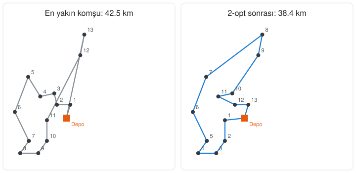

# Delivery Route Planner


A Python project that calculates a **short route** that leaves a depot, visits every delivery stop and returns to the depot.

In summer 2026 I worked as a delivery driver for Amazon packages in Worms, Germany. Driving a full van on a tight schedule every day, I kept thinking about the best order to make the deliveries. This project is my attempt to solve that everyday problem with what I'm learning in computer engineering.

<p align="center">
  
</p>

*Left: the route found by the nearest-neighbour method. Right: the same route improved with 2-opt. The crossing paths disappear and the route becomes about 10% shorter.*

## The problem

This is known in computer science as the **Traveling Salesman Problem**. As the number of stops grows, trying every possible order quickly becomes impossible: with just 15 stops there are about 43 billion different orders. So the project uses two fast heuristics that give good results:

1. **Nearest neighbour:** at each step, go to the closest stop that hasn't been visited yet. Very fast, but the route is usually longer than the best one.
2. **2-opt improvement:** pick two edges of the route; if reconnecting them crosswise and reversing the part in between makes the route shorter, apply the change. Repeat until no improvement is left. This is especially good at removing crossing paths.

Distances are calculated with the **haversine formula**, which gives the straight-line distance between two coordinates on the Earth's surface.

## Usage

```bash
pip install -r requirements.txt
python -m rota ornek_veri/worms_duraklar.csv --grafik rota.png
```

Sample output (the program's messages are in Turkish):

```
13 teslimat noktasi, depo: Depo (Worms merkez)

En yakin komsu rotasi :  42.52 km
2-opt sonrasi         :  38.36 km  (9.8% daha kisa)
Hesaplama suresi      : 0.1 ms

Onerilen sira:
   1. Pfiffligheim
   2. Horchheim
   3. Wiesoppenheim
   ...
```

To use your own stops, create a CSV file with `ad,enlem,boylam` (name, latitude, longitude) columns. The first row is treated as the depot (starting point).

```csv
ad,enlem,boylam
Depo,49.6320,8.3590
Herrnsheim,49.6560,8.3410
```

> The sample data uses approximate center coordinates of neighbourhoods in Worms. It contains no real delivery addresses.

## Tests

```bash
pip install -r requirements-dev.txt
pytest -v
```

The tests check the distance calculation (against a known distance such as Istanbul–Ankara), that every stop is visited exactly once and the route returns to the depot, that 2-opt never makes a route longer, and that on small examples it stays within 10% of a brute-force solution that tries every order. They run on every push with GitHub Actions on Windows and Linux, with Python 3.10 and 3.12.

## Project structure

```
rota/
  model.py         Stop data structure
  mesafe.py        Haversine distance and distance matrix
  algoritmalar.py  Nearest neighbour, 2-opt and brute force
  veri.py          CSV reading and validation
  gorsel.py        Route chart with Matplotlib
  __main__.py      Command-line interface
tests/
  test_rota.py
```

## Ideas for improvement

- Real road distances instead of straight-line ones (OpenStreetMap / OSRM)
- Delivery time windows ("deliver to this address before 14:00")
- Vehicle capacity and multiple vehicles (Vehicle Routing Problem, VRP)

## Author

**Yusuf Karatepe**, Computer Engineering student
[LinkedIn](https://www.linkedin.com/in/yusuf-karatepe-0720923a1/) · [GitHub](https://github.com/ysufkaratepe)
